<div align="center">

# B3 LIMS

**Your lab's samples, freezers, notebooks and shipments in one place — instead of twenty spreadsheets.**

[](LICENSE)


[Install in 5 minutes](#install-in-5-minutes) · [What you can do](#what-you-can-do) · [Screenshots](#screenshots) · [Documentation](docs/index.md) · [Roadmap](docs/development/local_install_and_eln_roadmap.md)

<a href="docs/screenshots/home.png">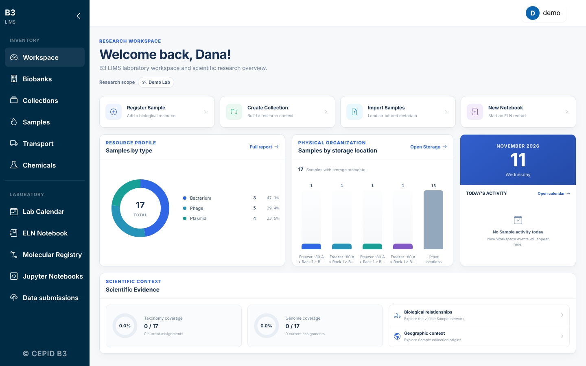</a>

<sub>Demo lab with fictional data (<code>biobank-local setup --demo</code>).</sub>

</div>

B3 LIMS is an open-source laboratory information system for biological sample collections — bacteria, phages, plasmids and, increasingly, other kinds of material. It was born in the [CEPID B3](https://www.b3.cepid.usp.br/](https://cepidb3.iq.usp.br/)) research center (bacteria and bacteriophage biology) to make samples traceable, governed and easy to share, and it is built so that **any lab can run it on its own computer or server**. It does not need a cluster, Slurm or institutional accounts; those stay optional.

## What you can do

| | Module | In one line |
|---|---|---|
| 🧫 | **Samples** | Register bacteria, phages, plasmids and more with typed fields, lineage, QR labels and sample tables you can fill in Excel. |
| ❄️ | **Storage** | Freezers, racks, boxes and compartments drawn on screen; click a position to place a sample; move boxes between workspaces. |
| 📓 | **Electronic lab notebook** | Experiments and protocols with templates, signatures that lock an entry, revisions, tags and links to the samples they used. |
| 🧬 | **Molecular registry** | DNA, RNA, plasmids, primers and proteins: maps, annotations, digests, primer Tm calculator, alignments, 3D structure. |
| ⚗️ | **Chemicals** | Reagent inventory, governance and stock movements. |
| 📦 | **Shipments & compliance** | Shipment planning, receipt, labels and the transport documents (MTA/TTM, biosafety, GMO/CIBio) your institution asks for. |
| 📅 | **Calendar & history** | Equipment booking, and one place to see who did what to which sample. |
| 🔬 | **Reference data** | Local taxonomy, GTDB and ICTV virus indexes to name organisms consistently, without calling a web service. |
| 🌐 | **Public catalog** | Optionally publish chosen collections as a read-only public page. |

Access is role-based (biobank, collection, research group), and every download and export goes through a permission check.

## Screenshots

<table>
<tr>
<td width="50%"><a href="docs/screenshots/storage.png">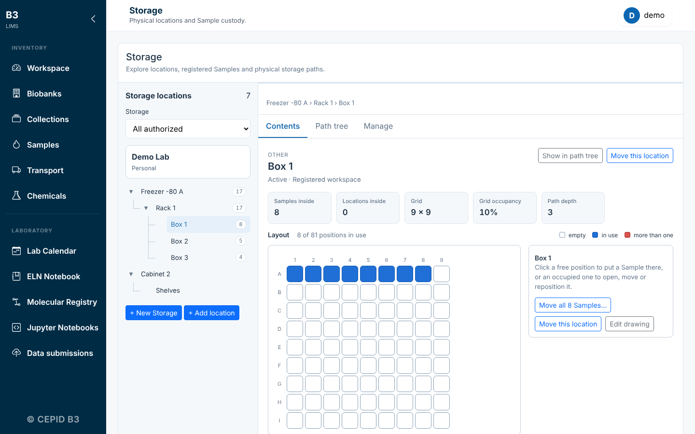</a><br><b>Storage.</b> A box drawn as a grid, with the occupied positions highlighted.</td>
<td width="50%"><a href="docs/screenshots/sample-new.png">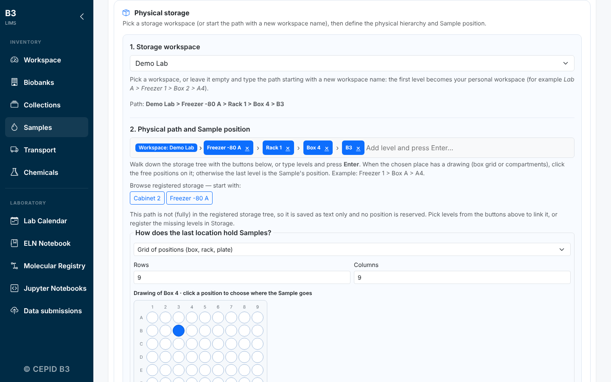</a><br><b>Register a sample.</b> Type the path or click the position on the drawing; new boxes and workspaces are created as you go.</td>
</tr>
<tr>
<td width="50%"><a href="docs/screenshots/sample-detail.png">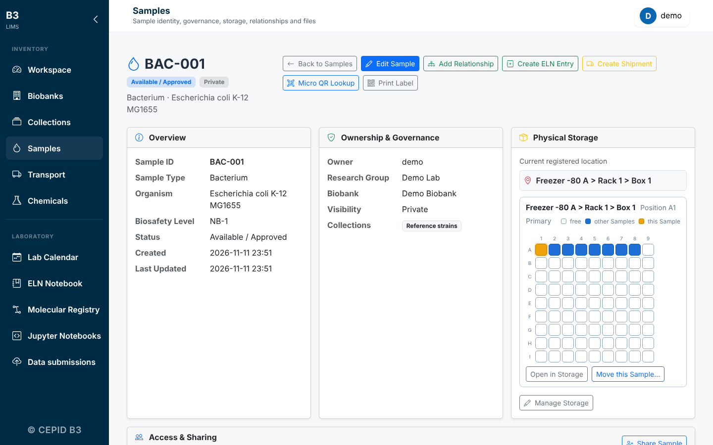</a><br><b>Sample page.</b> Identity, governance, files, relationships and exactly where the tube is.</td>
<td width="50%"><a href="docs/screenshots/samples.png">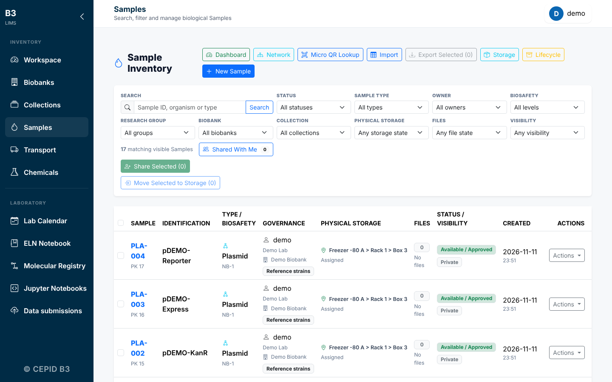</a><br><b>Sample list.</b> Filter by type, biobank, collection or status.</td>
</tr>
<tr>
<td width="50%"><a href="docs/screenshots/import.png">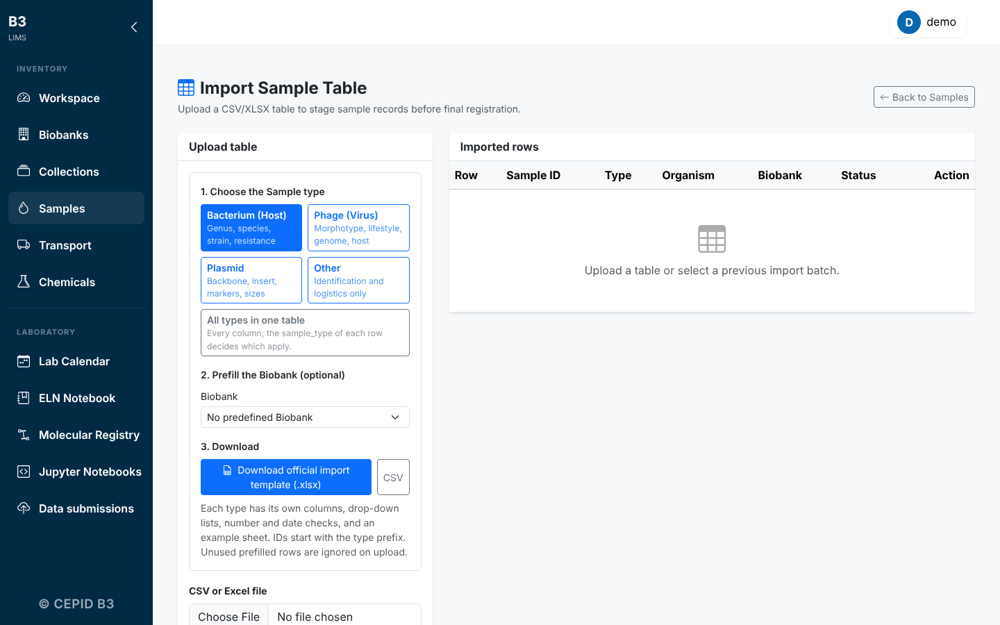</a><br><b>Sample tables.</b> Download a template for each sample type, fill it in Excel, import and fix any row on screen.</td>
<td width="50%"><a href="docs/screenshots/notebook.png">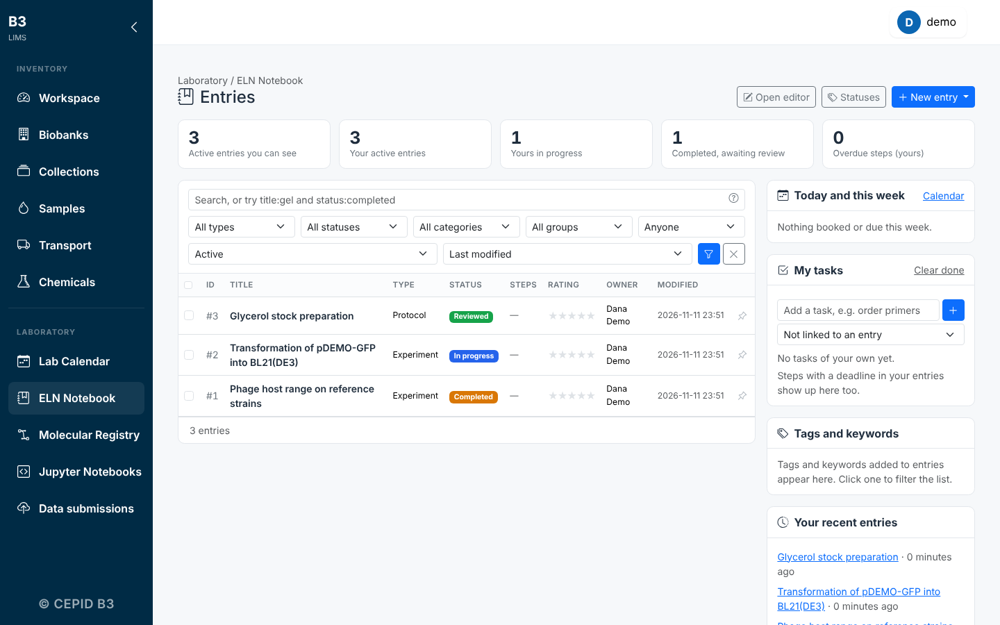</a><br><b>Lab notebook.</b> Entries with status, tags and the samples they used.</td>
</tr>
<tr>
<td width="50%"><a href="docs/screenshots/notebook-entry.png">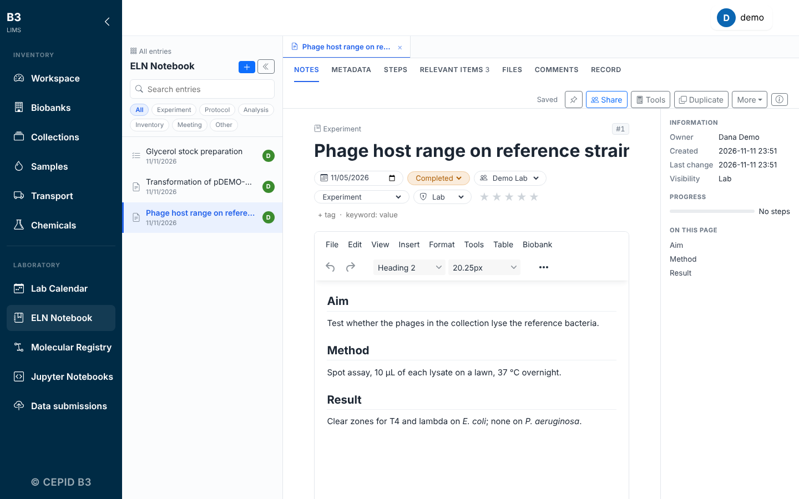</a><br><b>An entry.</b> Rich text, steps, tables, attachments, signature and revisions.</td>
<td width="50%"><a href="docs/screenshots/molecular-record.png">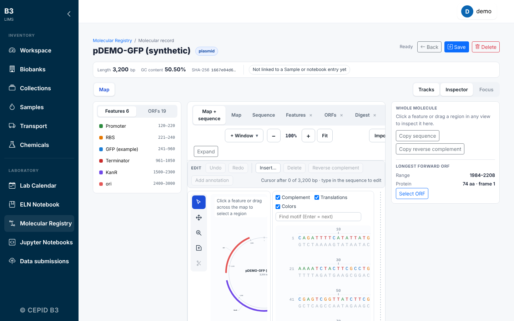</a><br><b>Molecular registry.</b> Circular map, features, sequence, ORFs and digest in one record.</td>
</tr>
</table>

## Install in 5 minutes

Pick the way that suits you. All three give you the same application, and none needs a cluster.

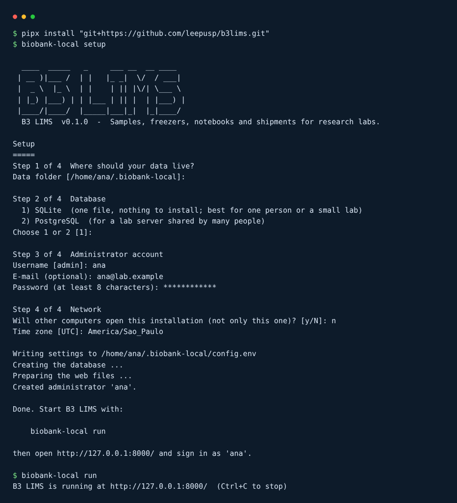

### Option 1: pip / pipx and the setup wizard

You need Python 3.12 or newer.

```bash
pipx install "git+https://github.com/leepusp/biobank.git"
biobank-local setup        # four questions: data folder, database, administrator, network
biobank-local run          # then open http://127.0.0.1:8000/
```

Add `--demo` to `setup` to load a small fictional lab to explore (user `demo`).

### Option 2: Docker Compose

```bash
git clone https://github.com/leepusp/biobank.git && cd biobank
BIOBANK_ADMIN_PASSWORD='choose-a-long-password' docker compose up -d
```

Open <http://localhost:8000/> and sign in as `admin`. Your data lives in the `biobank-data` volume. For PostgreSQL add `--profile postgres` (see the comments in `docker-compose.yml`).

### Option 3: from source (development)

```bash
git clone https://github.com/leepusp/biobank.git && cd biobank
python -m venv .venv && . .venv/bin/activate
pip install -e .
biobank-local setup && biobank-local run
python manage.py test --settings=biobank.test_settings    # about a minute
```

### Everyday commands

| Command | What it does |
|---|---|
| `biobank-local run` | Start the application (add `--host 0.0.0.0` to let other computers in your network open it) |
| `biobank-local backup` | Archive the database folder, uploaded files and settings |
| `biobank-local migrate` | Update the database after installing a newer version |
| `biobank-local createuser NAME` | Add or reset an administrator |
| `biobank-local doctor` | Check the installation |

Details, PostgreSQL, sharing with the rest of the lab, HTTPS and upgrades: [docs/install.md](docs/install.md).

## Optional: clusters and institutional deployments

The version at CEPID B3 runs on the DaVinci cluster with PAM sign-in, Apache, PostgreSQL and Jupyter servers started through Slurm. That is one *deployment profile* of the same code, not a requirement. If you do want it — Slurm-launched Jupyter, shared reference indexes, PAM accounts, Gunicorn behind a reverse proxy — see [docs/hpc.md](docs/hpc.md) and [docs/operations/production.md](docs/operations/production.md).

## Documentation

| | |
|---|---|
| [Install and upgrade](docs/install.md) | pip, Docker, PostgreSQL, sharing in your network, backups |
| [User guide](docs/user-guide.md) | Samples, storage, sample tables, notebook, molecular registry |
| [Configuration](docs/configuration.md) | Every setting and environment variable |
| [Clusters and Slurm (optional)](docs/hpc.md) | What to switch on for an HPC deployment |
| [Production deployment](docs/operations/production.md) | Gunicorn, reverse proxy, backups, restores |
| [Roadmap](docs/development/local_install_and_eln_roadmap.md) | What is planned and in what order |
| [Contributing](CONTRIBUTING.md) · [Security](SECURITY.md) · [Changelog](CHANGELOG.md) | |

The documentation is also published as a website (`mkdocs serve` builds it locally).

## How it fits together

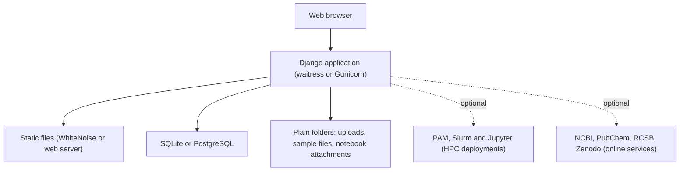

Two settings profiles share one code base: `biobank.standalone_settings` (a single computer or lab server, the default of `biobank-local`) and `biobank.settings` (the institutional deployment).

## Repository map

```text
biobank/
├── biobank/                  # settings (standalone and institutional), URLs, the biobank-local command
├── core/
│   ├── interfaces/           # templates
│   ├── static/               # CSS, JavaScript, vendored libraries
│   ├── models/               # domain models by feature
│   ├── permissions/          # all authorization rules
│   ├── services/             # business logic
│   ├── views/                # request handlers
│   ├── resources/            # forms and templates that ship with the package
│   └── management/commands/  # seed_demo, build_*_index, maintenance
├── bench/                    # Lab Calendar, equipment booking, tools
├── docs/                     # documentation and screenshots
├── deploy/                   # institutional deployment (Apache, systemd, PAM) — optional
├── Dockerfile, docker-compose.yml, pyproject.toml
└── manage.py
```

## Status

Biobank is under active development and is used in production at CEPID B3. The local installation path is new: please [open an issue](https://github.com/leepusp/biobank/issues) if something does not work on your machine. Sample records are sensitive; keep real data, credentials and `config.env` out of Git, issues and screenshots.

## Contributing and license

Contributions are welcome: see [CONTRIBUTING.md](CONTRIBUTING.md). English is the language of the code, interface and documentation.

Biobank is free software under the [GNU Affero General Public License v3.0](LICENSE): you may use, study, change and share it; if you run a modified version as a service for others, you must offer them its source.

Developed within CEPID B3 — FAPESP.
