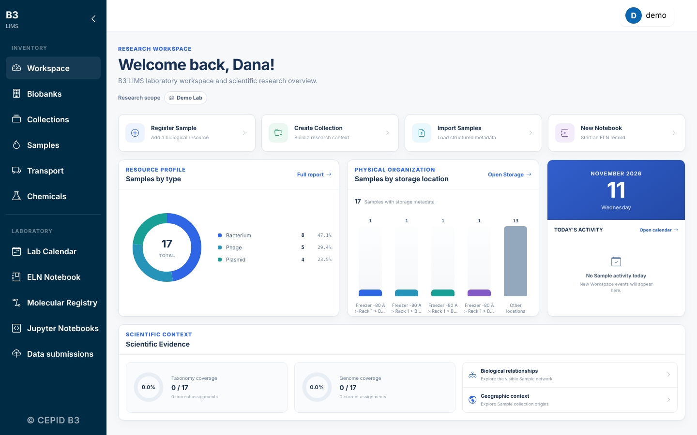

# B3 LIMS documentation

B3 LIMS is an open-source system for the samples, freezers, notebooks and shipments of a research lab. It runs on one computer, on a lab server or on a cluster.



| I want to... | Read |
|---|---|
| Install it and try it | [Install and upgrade](install.md) |
| Learn what each module does | [User guide](user-guide.md) |
| Change a setting | [Configuration](configuration.md) |
| Run it for many people behind HTTPS | [Production deployment](operations/production.md) |
| Use Slurm, PAM or Jupyter servers | [Clusters (optional)](hpc.md) |
| See what is planned | [Roadmap](development/local_install_and_eln_roadmap.md) |
| Contribute code | [Contributing](https://github.com/leepusp/b3lims/blob/main/CONTRIBUTING.md) |

## The shortest path

```bash
pipx install "git+https://github.com/leepusp/b3lims.git"
biobank-local setup --demo
biobank-local run
```

Open <http://127.0.0.1:8000/> and sign in with the administrator you created, or as `demo` (password `demo-password-123`) to explore the fictional demo lab. Change or remove the demo user before real use.
