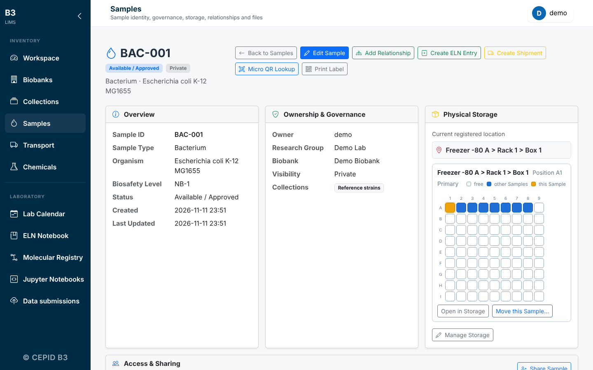
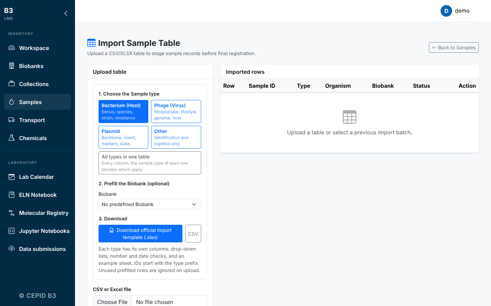
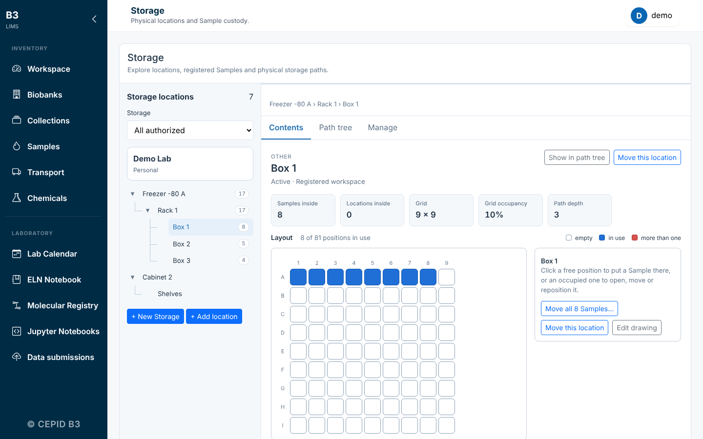
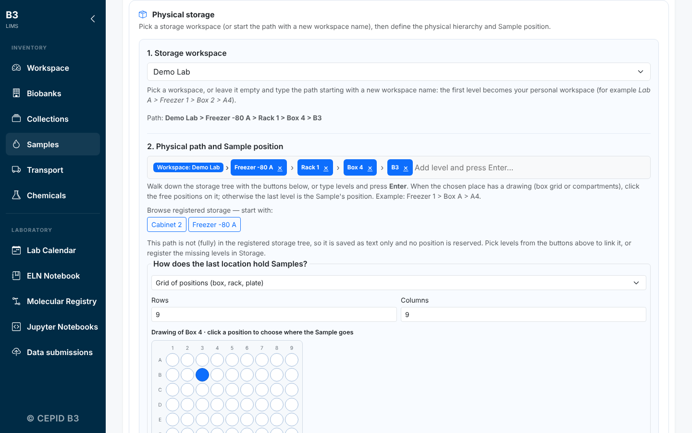
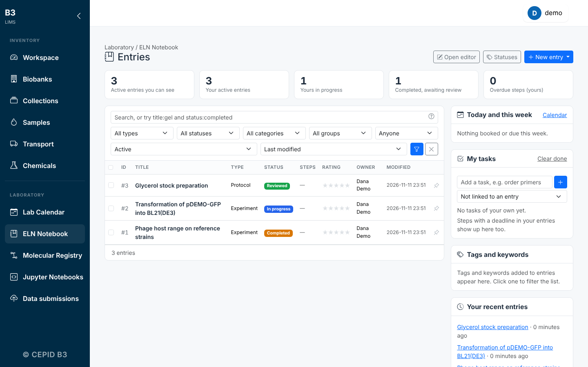
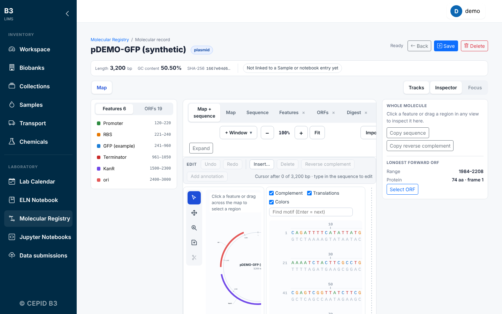

# User guide

A short tour of the modules. Every screenshot is from the fictional demo lab (`biobank-local setup --demo`).

## Samples

**Samples** hold the identity of a biological item: ID, type (bacterium, phage, plasmid, other), organism, biosafety level, owner, research group, biobank and collections. Type-specific fields appear for the type you pick, and IDs get a prefix per type (`BAC-`, `PHA-`, `PLA-`, `SMP-`).

### Many samples at once: sample tables

Open **Samples > Import**, choose a sample type and download its template (Excel or CSV). Columns are typed (numbers, dates, drop-down lists), an example sheet shows a filled row, and the file is checked when you upload it. A row with a problem shows an **Edit** button: fix it on screen and it is validated again, so you never have to re-upload.

## Storage

Storage is organised in **workspaces** (yours, or a research group's) that contain locations: freezer, rack, box, shelf. A box can be a **grid** (rows and columns) or have **named compartments**.

- When you register a sample, type the path (`Freezer A > Rack 1 > Box 2`) or pick the levels with the buttons. If the first level is new it becomes your workspace. When the last place has a drawing, click a free position on it.
- To move a box or a sample, select it in the tree and choose the destination; you can move between workspaces if you manage both sides. Every move is recorded in **History**.

## Electronic lab notebook

Entries (experiments, protocols, analyses) have rich text, steps, tables, attachments, tags and links to samples, reagents and molecular records. **Signing** an entry locks it; changes after that are amendments with a reason. Templates can be shared with your group.

## Molecular registry

Register DNA, RNA, plasmids, primers and proteins. Drop a GenBank, SnapGene, FASTA, EMBL or ApE file on the page: the name, type and sequence come from the file, and nothing has to be typed. Each record has a map, features, ORFs, restriction digest, a primer **Tm calculator** with adjustable reaction conditions, alignments and, for proteins, 3D structure.

## Shipments and compliance

Plan a shipment, generate the transport documents your institution asks for (MTA/TTM, sender and content declarations, GMO/CIBio notification), print package labels and record receipt.

## Calendar and history

The **Lab Calendar** books equipment. **History** lists what was done to samples (entries, moves, changes); you see your own activity, and administrators see everything.

## Who can see what

Access follows roles at three levels: **biobank** (owner, manager, editor, viewer), **collection** and **research group**. Samples are private until you share them or mark them public. Every file download and export checks permission.
